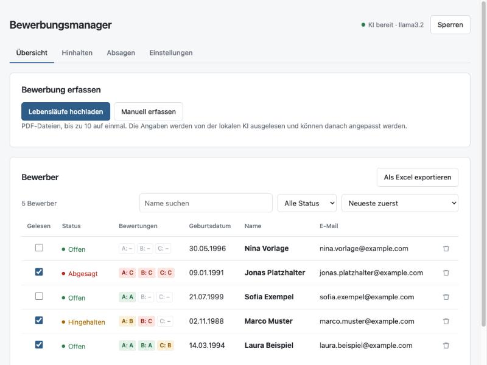
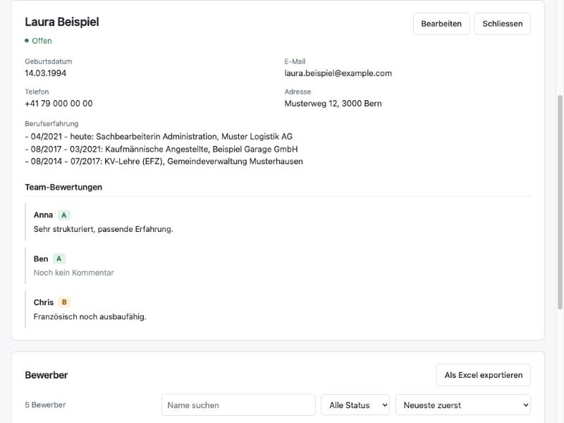

# Bewerbungsmanager

Ein lokales Tool zur Verwaltung von Bewerbungen für kleine Teams:
Lebensläufe als PDF hochladen, eine **lokale KI** liest die wichtigsten Daten aus, das Team bewertet die Kandidaten, und Zwischenbescheide bzw. Absagen werden mit einem Klick vorbereitet.

Alle personenbezogenen Daten werden **im Browser verschlüsselt**, bevor sie gespeichert werden. Lebensläufe verlassen den eigenen Computer nie.



## Funktionen

- **KI-Lebenslauf-Parser:** Bis zu 10 PDFs gleichzeitig hochladen. Name, Geburtsdatum, Kontaktdaten und Berufserfahrung werden automatisch erkannt (lokal über [Ollama](https://ollama.com)).
- **Manuelle Erfassung und Bearbeitung** aller Angaben.
- **Team-Bewertungen:** Jedes Team-Mitglied vergibt A/B/C und schreibt einen Kommentar.
- **Status-Verwaltung:** Offen, Hingehalten oder Abgesagt, dazu eine Gelesen-Markierung.
- **E-Mail-Vorlagen:** Zwischenbescheid („Hinhalten“) und Absage öffnen sich vorausgefüllt im Mailprogramm. Der Status wird automatisch nachgeführt.
- **Suchen, filtern, sortieren:** unter anderem ein Filter für „unvollständig bewertet“.
- **Excel-Export** aller Bewerber inklusive Bewertungen und Kommentaren.
- **Einstellungen:** Team-Mitglieder, Firmenname und Mail-Vorlagen sind frei anpassbar.
- **Beispieldaten:** Fiktive Bewerber zum Ausprobieren mit einem Klick.



## Installation

**Voraussetzungen**

- [Node.js](https://nodejs.org) ab Version 22.13
- Optional für den PDF-Import: [Ollama](https://ollama.com). Ohne Ollama funktionieren alle anderen Funktionen trotzdem.

**Schritte**

```bash
git clone https://github.com/<benutzername>/bewerbungsmanager.git
cd bewerbungsmanager
npm install
```

KI-Modell herunterladen (einmalig, ca. 6.6 GB):

```bash
ollama pull qwen3.5
```

Starten:

```bash
npm start
```

Danach im Browser <http://localhost:3000> öffnen. Beim ersten Start legen Sie ein Master-Passwort fest.

Zum Ausprobieren eignet sich der fiktive Lebenslauf in [`samples/`](samples/) oder die Schaltfläche **Beispieldaten laden**.

## Konfiguration

Optional `.env.example` nach `.env` kopieren und anpassen:

| Variable | Standard | Bedeutung |
|---|---|---|
| `PORT` | `3000` | Port des Servers |
| `HOST` | `127.0.0.1` | `127.0.0.1` = nur von diesem Computer erreichbar |
| `OLLAMA_URL` | `http://localhost:11434` | Adresse von Ollama |
| `OLLAMA_MODEL` | `qwen3.5` | Beliebiges Ollama-Modell, siehe unten |
| `DB_PATH` | `./data/bewerbungen.db` | Speicherort der Datenbank |

Team, Firmenname und Mail-Vorlagen werden direkt in der App unter **Einstellungen** gepflegt.

### Wahl des KI-Modells

Getestet mit einem zweiseitigen Lebenslauf in zweispaltigem Layout:

| Modell | Grösse | Dauer | Ergebnis |
|---|---|---|---|
| `qwen3.5` | 6.6 GB | ca. 30 s | Alle Stationen korrekt, gute Zusammenfassung (empfohlen) |
| `llama3.1:8b` | 4.9 GB | ca. 25 s | Stationen korrekt, Positionen fehlen teilweise |
| `gemma3:4b` | 3.3 GB | ca. 17 s | Zeiträume korrekt, Berufsbezeichnungen teils erfunden |
| `llama3.2` | 2.0 GB | ca. 13 s | Für schwächere Rechner. Erfindet gelegentlich Stellen |

Kontaktangaben (Geburtsdatum, E-Mail, Telefon) werden nur übernommen, wenn sie tatsächlich im PDF vorkommen. Erfundene Werte kleiner Modelle fallen so automatisch weg.

## Architektur

```
Browser                                   Server (Node.js/Express)          Lokal
┌──────────────────────────────┐          ┌──────────────────────────┐
│ Master-Passwort              │          │                          │
│   │ PBKDF2 (600 000 Runden)  │          │                          │
│   ▼                          │          │                          │
│ AES-256-GCM-Schlüssel        │  nur     │  SQLite                  │
│   │ verschlüsseln            │ Chiffre- │  (status, gelesen,       │
│   ▼                          │  text ──►│   verschlüsselte Daten)  │
│ Bewerberdaten, Bewertungen,  │          │                          │
│ Einstellungen                │          │                          │
│                              │   PDF    │  pdf-parse ─► Ollama ────┼──► KI-Modell
│ PDF-Upload ──────────────────┼─────────►│  (nur im Arbeitsspeicher)│
│ ◄── extrahierte Felder ──────┼──────────│                          │
└──────────────────────────────┘          └──────────────────────────┘
```

- **Ende-zu-Ende-Verschlüsselung** mit der Web Crypto API: Der Schlüssel existiert nur im Arbeitsspeicher des Browsers. In der Datenbank stehen ausser dem Status nur verschlüsselte Daten.
- **Passwortprüfung** über einen verschlüsselten Prüfwert. Ein falsches Passwort wird abgewiesen, statt unlesbare Einträge zu erzeugen.
- **PDFs** werden nur im Arbeitsspeicher verarbeitet und nie auf die Festplatte geschrieben.
- **Ollama** erhält über Structured Outputs ein JSON-Schema mit eigenen Feldern pro beruflicher Station (Zeitraum, Position, Firma, Ort, Tätigkeiten). Die Antwort ist dadurch immer valides JSON; der Server setzt daraus den Text zusammen.
- **Keine Cloud, kein Build-Schritt:** Express, SQLite (`node:sqlite`, in Node.js eingebaut) und Vanilla-JavaScript mit ES-Modulen. Das Frontend lädt keine externen Ressourcen.

### Projektstruktur

```
server.js            REST-API und Upload
src/db.js            SQLite-Zugriff
src/ai.js            PDF-Text auslesen und Ollama ansprechen
public/index.html    Oberfläche (Single Page)
public/js/
  app.js             Ablauf, Darstellung, Ereignisse
  crypto.js          Schlüsselableitung, Ver- und Entschlüsselung
  api.js             Zugriff auf die REST-API
  excel.js           Excel-Export (ExcelJS, im Browser)
  defaults.js        Standard-Einstellungen und Demo-Daten
  util.js            Hilfsfunktionen
samples/             Fiktiver Lebenslauf zum Testen
```

## Datensicherung

Alle Daten liegen in der Datei `data/bewerbungen.db`. Für ein Backup genügt es, diese Datei zu kopieren. Sie ist ohne das Master-Passwort unlesbar.

> **Wichtig:** Das Master-Passwort kann nicht wiederhergestellt werden. Ohne Passwort sind die Daten verloren. Um neu zu beginnen, die Datei `data/bewerbungen.db` löschen.

## Hinweise und Grenzen

- Gedacht für den Betrieb auf dem eigenen Computer. Der Server hat keine eigene Benutzerverwaltung und lauscht deshalb standardmässig nur auf `127.0.0.1`.
- Eingescannte PDFs (reine Bilder ohne Text) können nicht ausgelesen werden.
- Die Qualität der Extraktion hängt vom gewählten KI-Modell ab. Ergebnisse sollten kontrolliert werden.
- Die Web Crypto API funktioniert nur über `localhost` oder HTTPS.

## Lizenz

[MIT](LICENSE)
